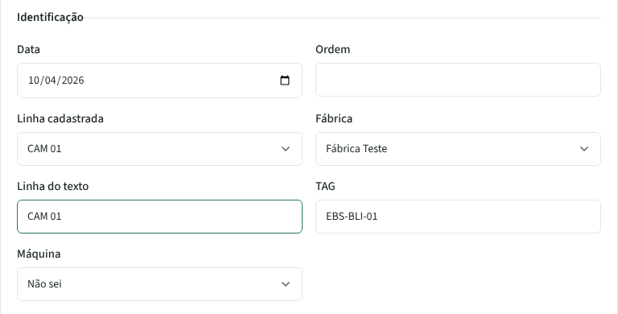
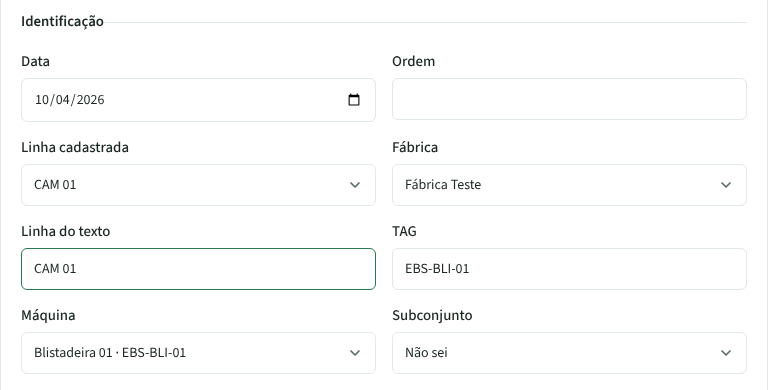
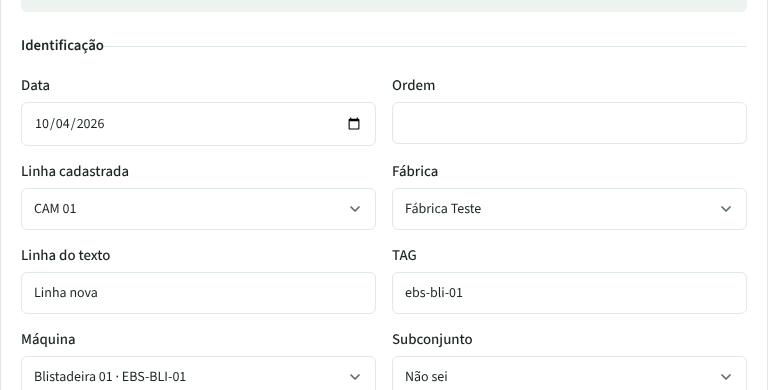

# PR #98 · RP: ao colar, a TAG do texto escolhe a máquina cadastrada

Texto colado: o rp1.txt dos exemplos, com `*LINHA:* CAM 01` e `*TAG:* EBS-BLI-01`. No cadastro local, a Blistadeira 01 da CAM 01 tem essa TAG.

| | |
|---|---|
| **Antes:** a linha vem certa, mas Máquina fica em "Não sei" |  |
| **Depois:** Máquina já vem como "Blistadeira 01 · EBS-BLI-01" |  |
| **Depois, linha do texto sem cadastro** (`Linha nova`, TAG em minúsculas): a máquina traz a linha CAM 01 e a fábrica |  |
