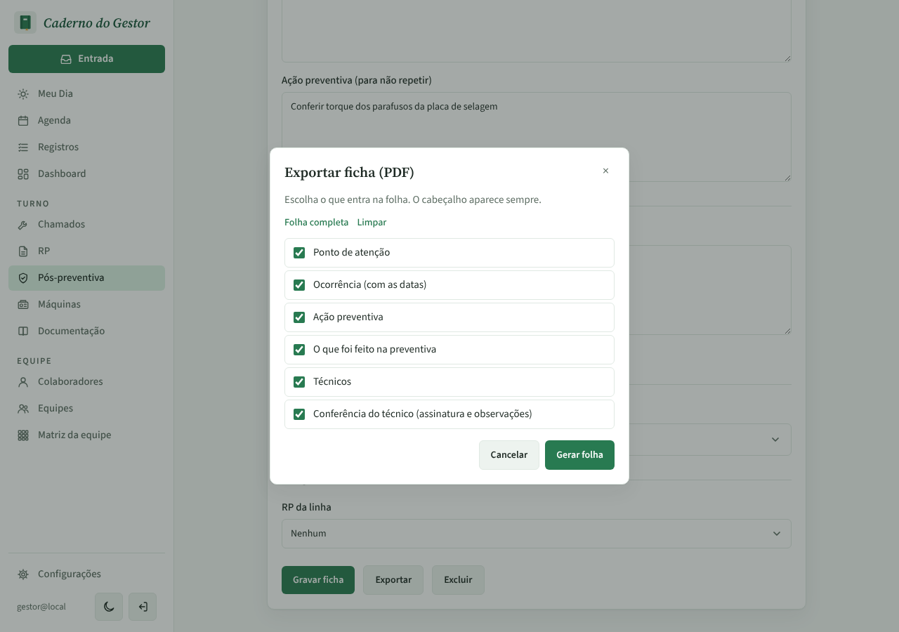
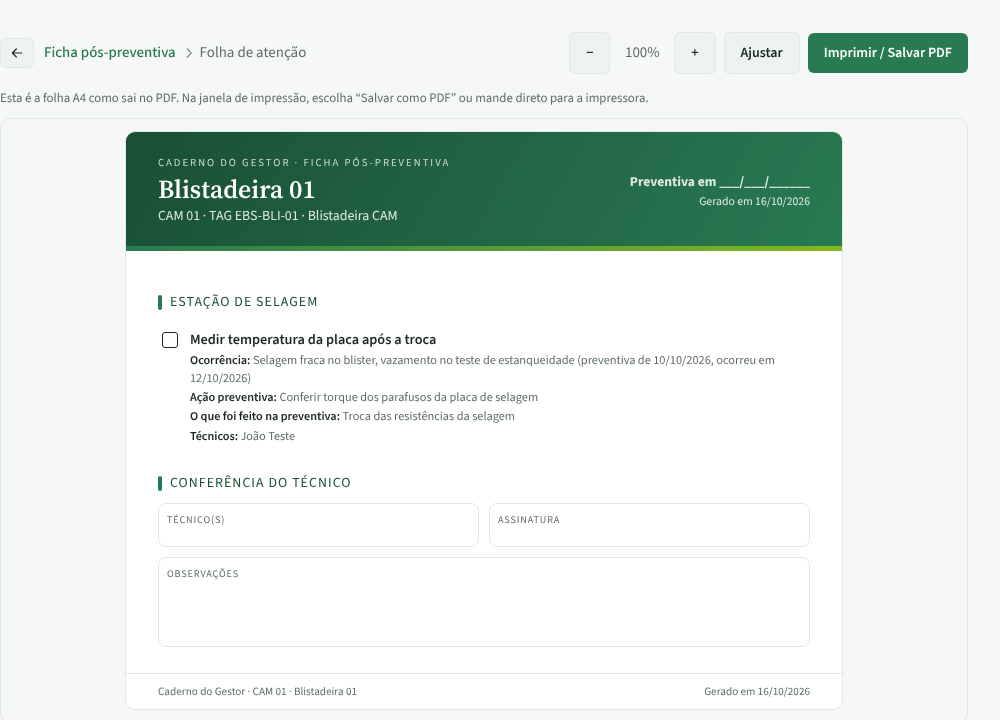
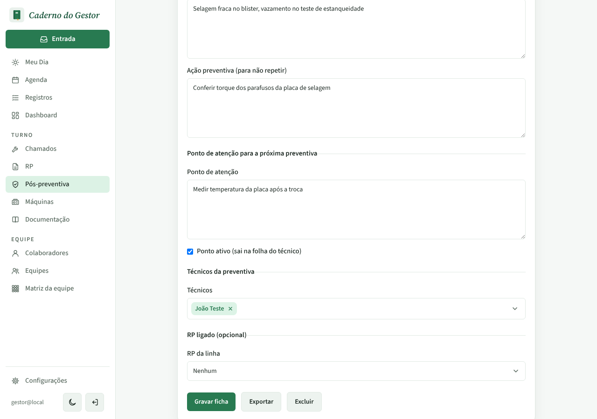
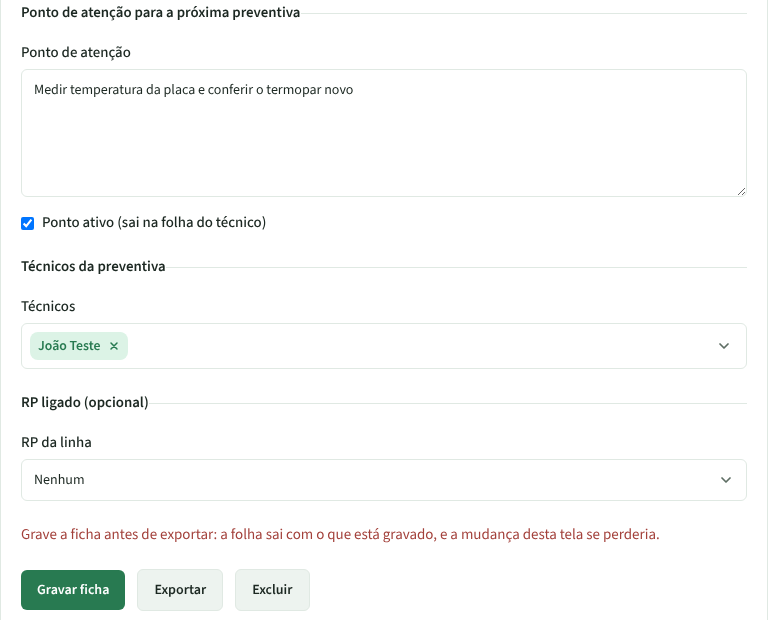
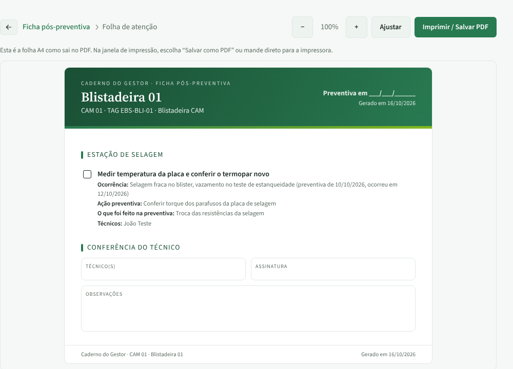

# PR #99 · Pós-preventiva: Exportar pede para gravar antes quando há mudança

Ficha da Blistadeira 01. Troquei o ponto de atenção de "Medir temperatura da placa após a troca" para "Medir temperatura da placa e conferir o termopar novo", sem gravar, e cliquei em Exportar.

| | |
|---|---|
| **Antes 1:** Exportar abre a janela mesmo com a mudança não gravada |  |
| **Antes 2:** "Gerar folha" sai com o texto antigo |  |
| **Antes 3:** ao voltar, o campo tem o texto antigo; o que foi digitado se perdeu |  |
| **Depois 1:** Exportar avisa para gravar antes e a mudança fica na tela |  |
| **Depois 2:** depois de "Gravar ficha", Exportar sai com o texto novo |  |
